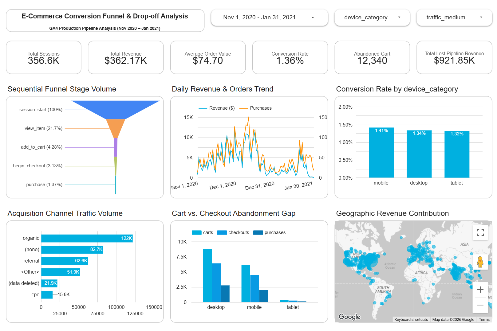
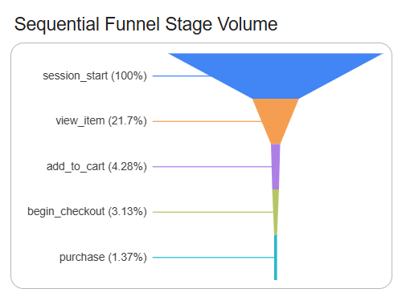

# Enterprise E-Commerce Funnel & Pipeline Drop-off Analysis (GA4 + BigQuery + Looker Studio)

An enterprise-grade e-commerce analytics dashboard and dimensional data model engineered using Google Analytics 4 (GA4) event-level BigQuery exports and Google Looker Studio.

This project resolves fundamental data engineering challenges inherent in raw clickstream event-streams: **grain mismatch**, **midnight boundary date attribution errors**, **non-linear checkout paths**, and **cart abandonment pipeline valuation**.

---
## Live Demo
Check out the live dashboard [here](https://datastudio.google.com/u/0/reporting/c795a25b-2ec4-4f95-a113-5bd74d4bf37e/page/Vk8CG)


---



---

## Executive Summary & Performance Metrics

| Metric | Production Value | Mathematical & Attribution Logic | 
| ----- | ----- | ----- | 
| **Total Sessions** | **356.6K** ($356,626$) | $\text{COUNT(DISTINCT } unique\_session\_id \text{)}$ across entire dataset | 
| **Total Realized Revenue** | **\$362.17K** ($\$362,168.00$) | $\sum(\text{session revenue})$ | 
| **Average Order Value (AOV)** | **\$74.70** | $\sum(\text{session revenue}) \div {NULLIF}(\sum(\text{has purchase}), 0)$ | 
| **Overall Conversion Rate** | **1.36%** | $\sum(\text{has purchase}) \div {NULLIF}(\text{COUNT(DISTINCT } unique session id \text{)}, 0)$ ($4,848 \div 356,626$) | 
| **Cart Abandoned Sessions** | **12,340** | $\sum(\text{CASE WHEN } has cart = 1 \text{ AND } has purchase = 0 \text{ THEN } 1 \text{ ELSE } 0 \text{ END})$ | 
| **Lost Pipeline Opportunity** | **\$921.85K** | $\sum(\text{is cart abandoned}) \times \left(\sum\text{session revenue} \div {NULLIF}(\sum\text{has purchase}, 0)\right)$ | 

## Architecture Overview

Standard GA4 exports present structural challenges when attempting to serve both sequential stage drop-offs and executive KPIs simultaneously. Modeling everything in a single event-level table creates multiplicative double-counting when aggregating metrics like sessions, AOV, and abandonment. Conversely, collapsing everything to a session summary destroys the ability to chart multi-step progression.

This system implements a **Dual-Grain Dimensional Data Architecture**:

```
                                  [Raw GA4 Event Stream]
                                             │
                                             ▼
                        [fact_events] + [dim_* Star Schema]
                                             │
                    ┌────────────────────────┴────────────────────────┐
                    ▼                                                 ▼
        [vw_funnel_reporting]                             [vw_sessions_reporting]
            (Event Grain)                                      (Session Grain)
                    │                                                 │
      ┌─────────────┴─────────────┐                     ┌─────────────┴─────────────┐
      ▼                           ▼                     ▼                           ▼
Sequential Funnel          Acquisition Mix        Executive KPIs              Lost Opportunity
(Stage volume & drop)    (Channel distribution)  (Sessions, Rev, CVR, AOV)   (Abandoned sessions & $AOV)

```

### 1. Event-Grain Mart (`vw_funnel_reporting`)

* **Grain:** 1 row per event occurrence per session.

* **Dashboard Role:** Powers continuous funnel stages (`session_start` $\rightarrow$ `view_item` $\rightarrow$ `add_to_cart` $\rightarrow$ `begin_checkout` $\rightarrow$ `purchase`), time-series daily trend lines, and channel volume distribution.

* **Key Fields:** `unique_session_id`, `event_date`, `event_name`, `purchase_revenue_usd`, `traffic_source`, `traffic_medium`, `full_location`.

### 2. Strict Session-Grain Mart (`vw_sessions_reporting`)

* **Grain:** Exactly 1 row per `unique_session_id` ($356,626$ rows total).

* **Dashboard Role:** Powers top-row KPI scorecards, device breakdown comparisons, and cart abandonment financial impact.

* **Dimensional Consistency:** Uses `ARRAY_AGG(... ORDER BY event_timestamp ASC LIMIT 1)[OFFSET(0)]` to guarantee deterministic first-touch attribution for user, device, and acquisition attributes without row duplication.

## Technical Solutions & Engineering Challenges

### 1. Eliminating Midnight UTC Date Boundary Discrepancies

* **The Problem:** In multi-hour browsing sessions spanning across midnight (e.g., browsing starts at 11:55 PM UTC on Day 1, checkout completes at 12:05 AM UTC on Day 2), aggregating purely on `MIN(event_date)` caused daily trend charts (which plot the actual transaction day) to disagree with scorecard totals for single-day slices.

* **The Solution:** Engineered a dynamic outcome-first date attribution anchor in BigQuery:

  ```
  COALESCE(
    MAX(CASE WHEN f.event_name = 'purchase' THEN f.event_date END),
    MIN(f.event_date)
  ) AS event_date
  
  ```

  Financial events are pinned to the verified transaction date, while non-purchasing exploration sessions anchor to their arrival date, aligning time-series charts and scorecards completely.

### 2. Dissecting Non-Linear Funnel Behavior

* **The Discovery:** Out of **4,848** total purchasing sessions, only **2,848** logged an explicit `add_to_cart` event during that session.

* **Root-Cause Analysis:**

  * **2,848 Sessions (Standard Funnel):** Full sequential progression (`session_start` $\rightarrow$ `view_item` $\rightarrow$ `add_to_cart` $\rightarrow$ `begin_checkout` $\rightarrow$ `purchase`).

  * **2,000 Sessions (Express / Multi-Session):** Bypassed the cart step directly via 1-click checkout options (e.g., Apple Pay, Google Pay, PayPal Express) or resumed a cart loaded in a previous session.

* **Impact on Abandonment Math:**

  * Total cart additions: **15,188** sessions.

  * Same-session completions: **2,848** sessions.

  * True abandoned cart volume: $15,188 - 2,848 = \mathbf{12,340\text{ sessions}}$.

### 3. Dynamic Filter-Safe Financials

* Hardcoding average basket values (such as overall AOV of $\$74.70$) into SQL columns introduces skew when business users filter by segment (e.g., Mobile vs. Desktop vs. Tablet).

* **The Solution:** Base views export additive building blocks (`session_revenue`, `has_purchase`, `is_cart_abandoned`). Looker Studio evaluates weighted metrics dynamically:

$$
\text{Dynamic Lost Pipeline Revenue} = \sum(\text{is cart abandoned}) \times \left(\frac{\sum\text{session revenue}}{{NULLIF}(\sum\text{has purchase}, 0)}\right)
$$

* **Mobile:** 4,897 abandoned * $73.57 AOV = $360.27K

* **Desktop:** 7,184 abandoned * $75.96 AOV = $545.70K

* **Tablet:** 259 abandoned * $63.29 AOV = $16.39K

### 4. Resolving Ambiguous City Geocoding

* Unqualified city strings (e.g., `Saint John`, `London`, `Springfield`) cause geocoding collisions and unmapped points in Google Maps.

* **The Solution:** Create Calculated Field:

  ```
  CONCAT(u.city, ', ', u.country)
  
  ```

  Eliminated collisions and populated a clean, multi-cluster global density map across Americas, EMEA, and APAC regions.

## SQL Data Modeling Implementation

### Production View: `vw_sessions_reporting`

```
CREATE OR REPLACE VIEW `ecommerce-funnel-conversion.ecommerce_analytics.vw_sessions_reporting` AS
WITH session_events AS (
  SELECT
    f.unique_session_id,

    -- 1. Date Anchor Alignment
    COALESCE(
      MAX(CASE WHEN f.event_name = 'purchase' THEN f.event_date END),
      MIN(f.event_date)
    ) AS event_date,
    
    MIN(f.event_datetime_utc) AS session_start_utc,
    
    -- 2. Deterministic First-Touch Dimensional Attribution
    ARRAY_AGG(f.user_pseudo_id IGNORE NULLS ORDER BY f.event_timestamp ASC LIMIT 1)[OFFSET(0)] AS user_pseudo_id,
    ARRAY_AGG(d.device_category IGNORE NULLS ORDER BY f.event_timestamp ASC LIMIT 1)[OFFSET(0)] AS device_category,
    ARRAY_AGG(d.operating_system IGNORE NULLS ORDER BY f.event_timestamp ASC LIMIT 1)[OFFSET(0)] AS operating_system,
    ARRAY_AGG(d.browser IGNORE NULLS ORDER BY f.event_timestamp ASC LIMIT 1)[OFFSET(0)] AS browser,
    
    ARRAY_AGG(t.traffic_source IGNORE NULLS ORDER BY f.event_timestamp ASC LIMIT 1)[OFFSET(0)] AS traffic_source,
    ARRAY_AGG(t.traffic_medium IGNORE NULLS ORDER BY f.event_timestamp ASC LIMIT 1)[OFFSET(0)] AS traffic_medium,
    ARRAY_AGG(t.campaign_name IGNORE NULLS ORDER BY f.event_timestamp ASC LIMIT 1)[OFFSET(0)] AS campaign_name,
    
    ARRAY_AGG(u.country IGNORE NULLS ORDER BY f.event_timestamp ASC LIMIT 1)[OFFSET(0)] AS country,
    ARRAY_AGG(u.city IGNORE NULLS ORDER BY f.event_timestamp ASC LIMIT 1)[OFFSET(0)] AS city,
    ARRAY_AGG(CONCAT(u.city, ', ', u.country) IGNORE NULLS ORDER BY f.event_timestamp ASC LIMIT 1)[OFFSET(0)] AS full_location,

    -- 3. Milestone Booleans
    MAX(CASE WHEN f.event_name = 'session_start' THEN 1 ELSE 0 END) AS has_session_start,
    MAX(CASE WHEN f.event_name = 'view_item' THEN 1 ELSE 0 END) AS has_view_item,
    MAX(CASE WHEN f.event_name = 'add_to_cart' THEN 1 ELSE 0 END) AS has_cart,
    MAX(CASE WHEN f.event_name = 'begin_checkout' THEN 1 ELSE 0 END) AS has_checkout,
    MAX(CASE WHEN f.event_name = 'purchase' THEN 1 ELSE 0 END) AS has_purchase,

    -- 4. Financial Base Fact
    SUM(COALESCE(f.purchase_revenue_usd, 0.0)) AS session_revenue

  FROM
    `ecommerce-funnel-conversion.ecommerce_analytics.fact_events` AS f
  LEFT JOIN
    `ecommerce-funnel-conversion.ecommerce_analytics.dim_devices` AS d
    ON f.device_id = d.device_id
  LEFT JOIN
    `ecommerce-funnel-conversion.ecommerce_analytics.dim_traffic_sources` AS t
    ON f.traffic_id = t.traffic_id
  LEFT JOIN
    `ecommerce-funnel-conversion.ecommerce_analytics.dim_users` AS u
    ON f.user_pseudo_id = u.user_pseudo_id
  GROUP BY
    f.unique_session_id
)
SELECT
  unique_session_id,
  user_pseudo_id,
  event_date,
  session_start_utc,
  device_category,
  operating_system,
  browser,
  traffic_source,
  traffic_medium,
  campaign_name,
  country,
  city,
  full_location,
  has_session_start,
  has_view_item,
  has_cart,
  has_checkout,
  has_purchase,
  session_revenue,
  CASE WHEN has_cart = 1 AND has_purchase = 0 THEN 1 ELSE 0 END AS is_cart_abandoned
FROM
  session_events;

```

## Looker Studio Metric Audit Reference

All dashboard metrics are dynamically computed at query time using the following formulas:

```
-- Conversion Rate (%)
SUM(has_purchase) / NULLIF(COUNT_DISTINCT(unique_session_id), 0)

-- Average Order Value ($)
SUM(session_revenue) / NULLIF(SUM(has_purchase), 0)

-- Abandoned Cart Volume
SUM(is_cart_abandoned)

-- Lost Pipeline Revenue ($)
SUM(is_cart_abandoned) * (SUM(session_revenue) / NULLIF(SUM(has_purchase), 0))

```

## Strategic Business Insights

1. **Cart Drop-Off Represents the Largest Revenue Leakage:**

   * While overall top-to-bottom conversion sits at **1.36%**, the cart-to-purchase drop-off accounts for **\$921.85K** in uncaptured pipeline value.

   * Implementing automated cart abandonment recovery sequences (email triggers, dynamic retargeting) targeting the **12,340** dropped sessions offers the highest immediate ROI.

2. **Device Conversion Uniformity:**

   * Conversion rates across devices remain steady (**Mobile: 1.41%**, **Desktop: 1.34%**, **Tablet: 1.32%**), proving desktop and mobile experiences maintain usability parity.

   * However, Desktop generates higher AOV (**\$75.96** vs. **\$73.57** on Mobile), driving greater overall value per checkout.

3. **The Power of Express Checkout:**

   * **41.3%** of all completed orders (2,000 of 4,848) bypassed standard cart interaction stages. Streamlining checkout entry points and prioritizing instant payment methods drives frictionless conversions.
